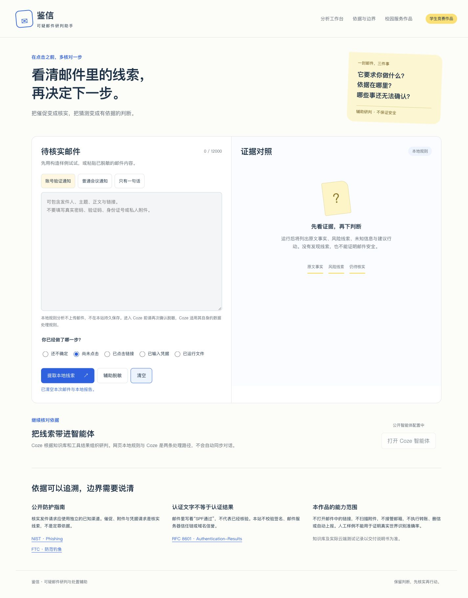

# 鉴信：可疑邮件研判助手（初版）

[在线体验](https://yun999-ccc.github.io/campus-service-assistant/jianxin/)

从用户粘贴的邮件中提取可观察线索，区分原文事实、风险提示和未知信息，并按已执行的操作整理下一步核实建议。

## 当前状态

此公开初版运行本地规则，Coze公开入口尚未接通，相关按钮保持禁用。不能将网页结果称作Coze模型研判。没有发现风险线索不等于安全，不提供真假认证、病毒扫描、域名信誉验证或SPF/DKIM校验。

样例全部为人工构造，使用示例域名，不能用来证明真实邮件识别准确率。

## 使用

选择样例或粘贴脱敏邮件，选择已执行的操作，点击“提取本地线索”。可导出报告，或准备待复制的脱敏内容。辅助脱敏并非完整隐私审查。邮件中的链接不会成为可点击链接，也不会自动访问；原文以纯文本呈现。

本站不上传或持久保存邮件。页面初始化读取本站coze-config.json；公开指南链接仅在用户点击时打开。Coze后续对话将适用该平台自己的规则。

## 本地运行与测试

从仓库根目录运行 `python3 -m http.server 4173 --bind 127.0.0.1`，访问 `http://127.0.0.1:4173/jianxin/`。

进入jianxin目录运行 `node --test tests/engine.test.js`。不需要安装npm包。

## 文件

index.html 页面；styles.css 样式；engine.js 本地线索提取与辅助脱敏；app.js 交互；coze-config.json 公开入口状态；tests/ 规则测试。

## 来源和权利

- [NIST Phishing](https://www.nist.gov/itl/smallbusinesscyber/guidance-topic/phishing)
- [FTC 防范钓鱼](https://consumer.ftc.gov/consumer-alerts/2024/09/dont-take-bait-phishing-scams)
- [RFC 8601](https://www.rfc-editor.org/rfc/rfc8601.html)

这是学生竞赛原型，与上述机构无隶属或背书关系。未额外授予源代码复用许可。
